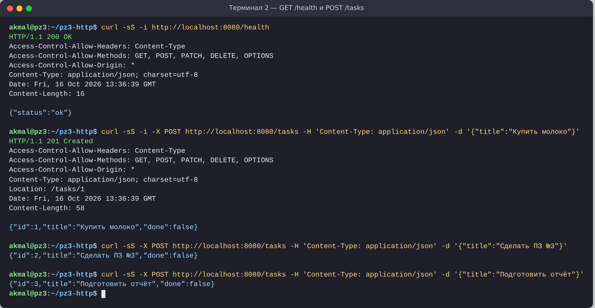
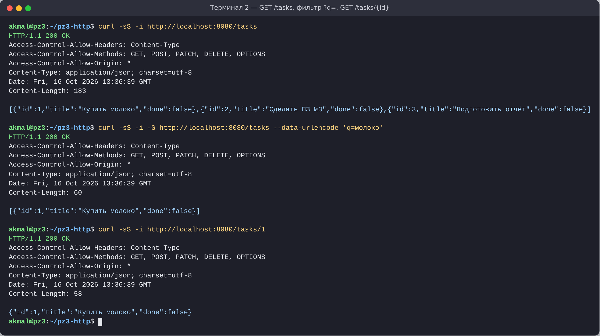
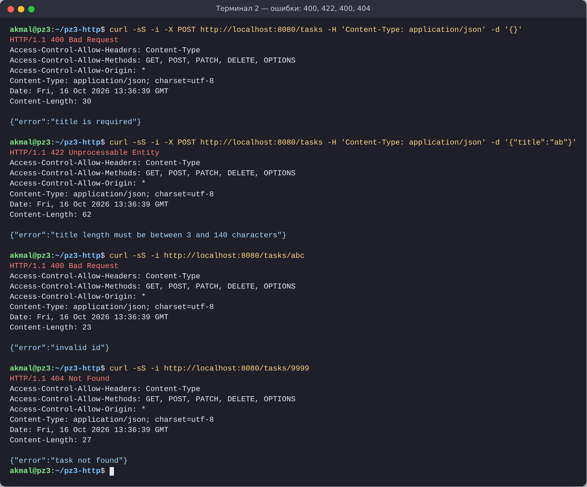
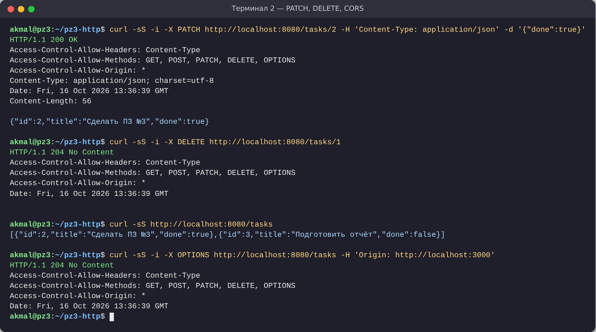
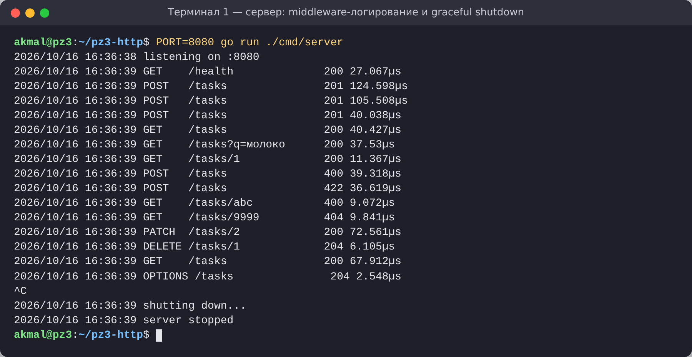
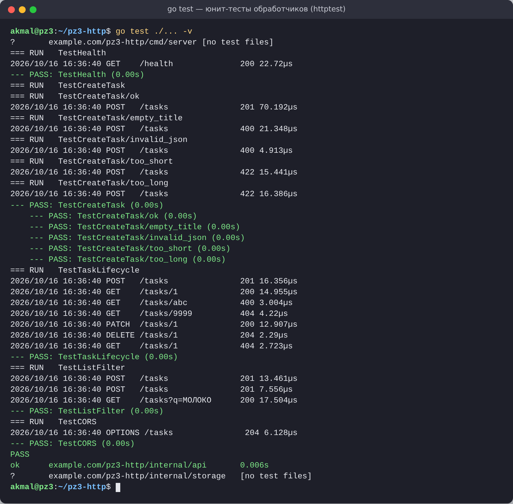

# ПЗ №3. Простой HTTP-сервер на net/http. Обработка запросов GET/POST

| | |
|---|---|
| **Дисциплина** | Технологии индустриального программирования |
| **Студент** | Абдулатифзода Акмал |
| **Группа** | ____________ |
| **Дата** | 16.10.2026 |
| **Преподаватель** | Адышкин С. С. |

REST API для списка задач на стандартной библиотеке `net/http`, без сторонних фреймворков и зависимостей.

## Окружение

Go 1.24.7 (нужен Go 1.22+ для маршрутов вида `GET /tasks/{id}`), Ubuntu 24.04, curl 8.5.

## Структура

```
pz3-http/
├── cmd/server/main.go            # запуск, PORT из окружения, graceful shutdown
├── internal/api/
│   ├── handlers.go               # обработчики GET/POST/PATCH/DELETE
│   ├── handlers_test.go          # юнит-тесты (httptest)
│   ├── middleware.go             # Logging, CORS, сборка маршрутов
│   └── responses.go              # единый helper для JSON-ответов и ошибок
├── internal/storage/memory.go    # потокобезопасное in-memory хранилище
├── requests.md                   # тестовые запросы curl / PowerShell
├── Makefile, run.ps1             # цели run, build, test
└── screenshots/
```

## Запуск

```bash
go run ./cmd/server               # или: make run      (Windows: .\run.ps1 run)
PORT=9090 go run ./cmd/server     # другой порт
make test                         # юнит-тесты      (Windows: .\run.ps1 test)
make build                        # бинарник в ./bin (Windows: .\run.ps1 build)
./scripts/demo.sh                 # все тестовые запросы (во втором терминале)
```

## Маршруты

| Метод и путь | Описание | Успех | Ошибки |
|---|---|---|---|
| `GET /health` | проверка состояния | 200 `{"status":"ok"}` | — |
| `GET /tasks?q=` | список, фильтр по подстроке (без учёта регистра) | 200 | — |
| `POST /tasks` | создать `{"title":"..."}` | 201 + `Location` | 400 (JSON, нет title, Content-Type), 422 (длина не 3–140) |
| `GET /tasks/{id}` | одна задача | 200 | 400 (id не число), 404 |
| `PATCH /tasks/{id}` | изменить `{"done":true}` | 200 | 400, 404 |
| `DELETE /tasks/{id}` | удалить | 204 | 400, 404 |
| `OPTIONS *` | CORS preflight | 204 | — |

Все запросы — в [requests.md](requests.md).

## Скриншоты

| | |
|---|---|
| GET /health, POST /tasks |  |
| Список, фильтр, задача по id |  |
| Ошибки 400 / 422 / 400 / 404 |  |
| PATCH, DELETE, CORS |  |
| Логи сервера и graceful shutdown |  |
| Юнит-тесты |  |

## Что сделано сверх обязательной части

* **Доп. часть:** PATCH и DELETE, валидация длины title (3–140 символов, иначе 422), CORS-middleware.
* **Домашнее задание:** порт из переменной `PORT` (по умолчанию 8080), `Makefile` и `run.ps1` с целями run/build/test, юнит-тесты на `httptest.NewRecorder` (5 тестов, 11 проверок).
* **«Звёздочка»:** graceful shutdown через `http.Server.Shutdown` с таймаутом 5 с, таймауты сервера.

## Исправление в коде из методички

В примере `GetTask` ошибка проверяется так: `errors.Is(err, errors.New("not found"))`. Каждый вызов `errors.New` создаёт **новое** значение, поэтому сравнение всегда ложно — и на несуществующую задачу сервер вернул бы **500** вместо 404. Исправлено через общую ошибку `storage.ErrNotFound`, объявленную один раз. Ещё одно изменение: `List()` сортирует задачи по id, иначе из-за случайного порядка обхода `map` список менялся бы от запроса к запросу.
